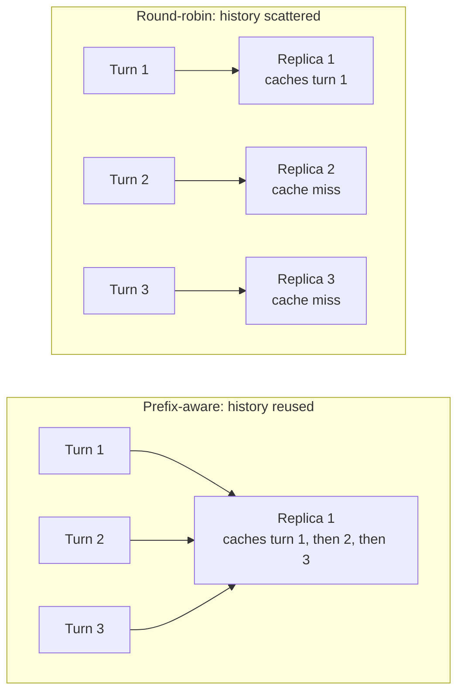
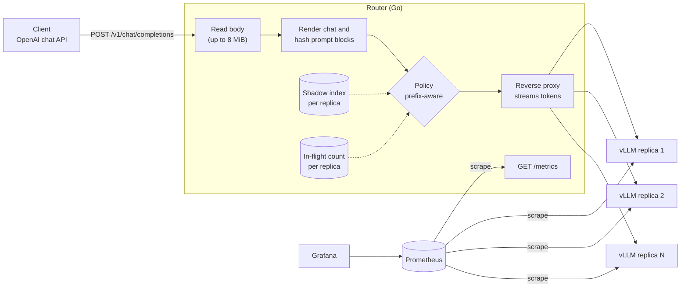
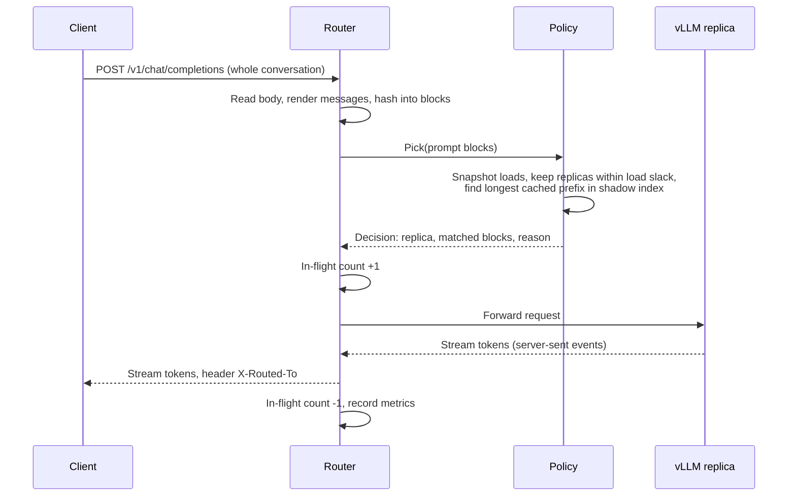
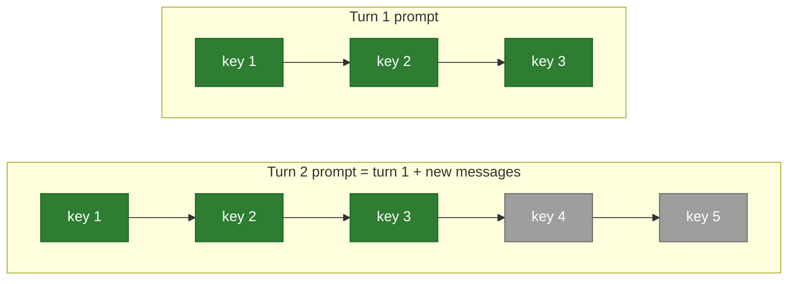
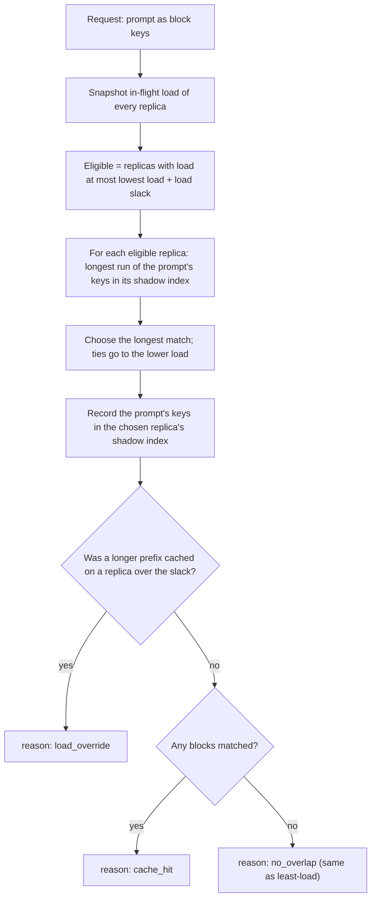
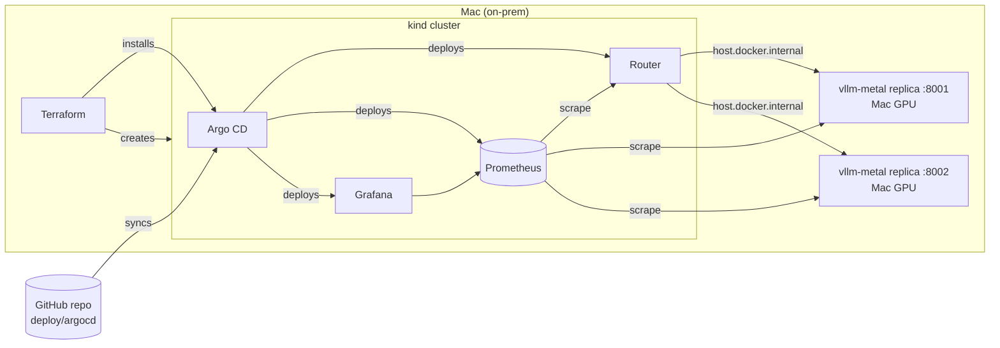

# llm-router

A KV-cache-aware load balancer for [vLLM](https://github.com/vllm-project/vllm) replicas, written in Go.

Multi-turn chat resends the whole conversation on every turn. vLLM's automatic
prefix caching can skip recomputing that history, but only on the replica that
already holds it. A cache-blind load balancer such as round-robin scatters a
conversation's turns across replicas, so most turns pay full prefill again.
This router sends each request to the replica most likely to have its prompt
prefix cached, as long as that replica isn't overloaded.



**GPU inference.** The router has been run and benchmarked against real vLLM
inference on an **Apple Silicon GPU** (M3 Pro, through
[vllm-metal](https://docs.vllm.ai/projects/vllm-metal), which runs vLLM on
Metal/MLX). Kubernetes manifests for **NVIDIA GPU** nodes
(`deploy/k8s/overlays/gpu`) are included, but haven't been run on NVIDIA
hardware yet.

## Design

### Architecture



The router is a single Go binary with no external state. It speaks the
OpenAI chat completions API on both sides, so clients and vLLM replicas need
no changes.

### Request lifecycle



1. **Read** the body (up to 8 MiB; larger is rejected with 413) and parse the
   `messages`. A body that can't be parsed is still forwarded unchanged and
   routed on load alone, so vLLM returns its own error for it.
2. **Render and hash.** The messages are flattened into one string and split
   into fixed-size blocks, each with a chained hash (below).
3. **Pick** a replica with the configured policy. The policy returns the
   replica plus why it chose it and how many blocks it expects to be cached.
4. **Count load.** The replica's in-flight counter goes up before proxying
   and down only when the response has finished streaming (or the client has
   gone away), so decode time counts as load.
5. **Proxy** with Go's reverse proxy, which flushes each server-sent event as
   it arrives, so tokens stream through without buffering. The response
   carries an `X-Routed-To` header naming the replica.
6. **Record metrics:** routing reason, predicted cache hits, status code,
   time to first byte and total duration.

### Prefix keys

vLLM's automatic prefix caching splits a prompt into fixed-size blocks and
keys each block by a hash chained over all blocks before it:

```
key(block i) = hash(key(block i-1) ‖ text of block i)
```

So one key stands for the entire prompt up to that block: block *i* is only
reusable if everything before it matches too. Multi-turn chat fits this
exactly, since every turn resends the earlier turns unchanged as a prefix:



Green blocks are already cached from turn 1, so only the grey ones cost
prefill. The router computes the same kind of keys (`internal/prefix`). It
has no tokenizer, so blocks are 64 characters (about vLLM's 16 tokens), and a
final partial block is dropped, as vLLM only caches full blocks.

### Shadow index

The router can't see inside the replicas' KV caches, so for each replica it
keeps an LRU set of the block keys it has sent there, sized like that
replica's real cache (`-cache-blocks`). It is an estimate: it can drift if a
replica restarts or evicts differently, and corrects itself as traffic is
recorded. The router only needs it to *rank* replicas; hit rates are always
reported from vLLM's own metrics, and the Grafana dashboard plots the
router's predicted hit rate next to vLLM's actual one so drift is visible.

### Routing policies

| Policy | Rule | Role |
|---|---|---|
| `round-robin` | Next replica in turn | Baseline: ignores load and content |
| `least-load` | Fewest in-flight requests | Baseline: load-aware, cache-blind |
| `prefix-aware` | Longest cached prefix among replicas that aren't overloaded | The router's policy |

`prefix-aware`, step by step:



With no overlap anywhere, this is least-load, which spreads out new
conversations. `-load-slack` (default 4) is how many extra in-flight
requests are worth accepting to get a cache hit: a hit saves prefill, but waiting
behind a busy replica costs whole decodes. Each decision is labelled with a
reason for the metrics: `cache_hit`, `no_overlap`, or `load_override` (a
longer prefix was cached on a replica that was over the slack).

Matching, choosing and recording happen under one lock, so two turns of a
conversation arriving together see each other's effect; hashing happens
before the lock to keep it short.

### Load tracking

Load is the router's own count of in-flight requests, not vLLM's
`num_requests_running` metric. Scraped metrics are seconds old, and in that
window every new request would see the same "idle" replica and pile onto it.
The router's count changes the instant a request is sent.

### Observability

The router exports Prometheus metrics on `/metrics`: requests by replica,
policy, reason and status code; in-flight requests per replica; prompt and
predicted-hit blocks; time to first byte and request duration; and its own
routing overhead. Labels are limited to replica, policy, reason and status
code, so the number of series stays small. Replicas export vLLM's standard
metrics, which the dashboard combines with the router's.

### Deployment



- **Terraform** owns the infrastructure: the cluster and Argo CD, plus one
  root Application.
- **Argo CD** owns everything else and deploys it from git, so a push to
  `main` updates the cluster.
- **Kustomize** keeps one router configuration with three choices of where
  inference runs:
  - `mac-gpu`: vllm-metal on the Mac's GPU, reached through `ExternalName`
    Services.
  - `local`: mock replicas inside the cluster.
  - `gpu`: vLLM pods on NVIDIA GPU nodes.
- **In-cluster replicas** run as a StatefulSet behind a headless Service, so
  each pod has its own DNS name (`vllm-0.vllm`, …). A normal Service would
  load-balance across them and hide which replica got the request, defeating
  the router.

### Design decisions and trade-offs

| Decision | Why | Cost |
|---|---|---|
| Character blocks, no tokenizer | No tokenizer dependency or per-request tokenization latency | Block boundaries don't match vLLM's exactly; predictions are approximate |
| Shadow index instead of querying replicas | No extra round trip per request; works with unmodified vLLM | Can drift from the real cache |
| Load slack instead of a weighted score | One parameter with a concrete meaning (extra in-flight requests accepted for a hit) | A shared system prompt can concentrate load up to the slack |
| Router-local load counts | Instant, no herding | Each router copy sees only its own traffic |
| A single router replica | Every request updates one shadow index | Not horizontally scalable yet; scaling needs routing by conversation in front of the routers |
| Lock around pick and record | Concurrent turns of one conversation stay consistent | Picks are serialized; all of the router's work before proxying averaged about 0.2 ms per request in testing |

## Components

| Path | What it is |
|---|---|
| `cmd/router` | The router: OpenAI-compatible `POST /v1/chat/completions` proxy with streaming, `GET /metrics`, `GET /healthz` |
| `internal/policy` | `round-robin` and `least-load` (baselines), `prefix-aware` |
| `internal/prefix` | Chat rendering, chained block hashing, LRU |
| `internal/backend` | Replica list, per-replica reverse proxy, in-flight counter |
| `cmd/mockvllm` | CPU-only vLLM stand-in: same API and metric names, LRU prefix cache, prefill cost only for uncached blocks, queueing like vLLM's `--max-num-seqs` |
| `cmd/loadgen` | Open-loop multi-turn chat load generator; reports TTFT percentiles and prefix-cache hit rate from replica metrics |
| `scripts/bench.sh` | Runs each policy on freshly started replicas (cold caches) with the same workload and prints a comparison; `RUNS=N` repeats with different seeds |
| `scripts/vllm-mac.sh`, `scripts/vllm.env` | Start vllm-metal replicas on the Mac GPU; the model and vLLM settings they share with `bench.sh` |
| `Dockerfile` | Builds any program in `cmd/` into a small distroless image |
| `deploy/k8s` | Kustomize manifests: router base; overlays for in-cluster mocks (`local`), Mac GPU replicas (`mac-gpu`) and NVIDIA GPU nodes (`gpu`) |
| `deploy/terraform/onprem` | Terraform: kind cluster, Argo CD and the root Application |
| `deploy/argocd` | Argo CD Applications: router, Prometheus, Grafana, dashboards |
| `deploy/local` | Prometheus and Grafana in Docker Compose, for running without Kubernetes |

## Setup

### Mock replicas (no GPU)

Requires Go 1.23+.

```sh
make test                          # unit tests, with the race detector
make run-mocks                     # 4 mock replicas on :8001-:8004
make run-router POLICY=prefix-aware   # router on :8090
make stop

make bench                         # benchmark all three policies (~10 min)
```

Send a request through the router:

```sh
curl -s localhost:8090/v1/chat/completions \
  -d '{"messages":[{"role":"user","content":"hello"}],"max_tokens":8}' -D - -o /dev/null \
  | grep -i x-routed-to
```

### Real vLLM on Apple Silicon

[vllm-metal](https://docs.vllm.ai/projects/vllm-metal) runs vLLM on a Mac's GPU
through MLX/Metal, with the same OpenAI API, prefix caching and Prometheus
metrics, so the router and load generator work unchanged.

```sh
brew tap vllm-project/vllm-metal https://github.com/vllm-project/vllm-metal
brew install vllm-project/vllm-metal/vllm-metal

BACKEND=vllm REPLICAS=2 ROUTER_ARGS="-cache-blocks 280" \
LOADGEN_ARGS="-rate 1 -sys-prompts 4 -sys-chars 800 -turns 6 -user-chars 200 -max-tokens 48 -think 1s" \
  scripts/bench.sh
```

Defaults start `mlx-community/Qwen3-0.6B-4bit` with settings that fit two
replicas on an 18 GB Mac (each replica uses about 3.7 GB).

`-cache-blocks` should match a replica's KV cache: its size in tokens ÷ 16.
vllm-metal logs the size at startup as `CPU KV cache size: N tokens` (on
Apple Silicon this is the same unified memory the GPU uses). With these
settings it varies from start to start, between about 6,000 and 10,400
tokens, so check the log. A value below the real size, like the 280 blocks
(4,480 tokens) above, is safe but makes the router forget conversations
sooner than vLLM does, so it understates the gain.

### On-prem Kubernetes (Terraform + Argo CD)

The router runs in a local [kind](https://kind.sigs.k8s.io) cluster and is
deployed by Argo CD from this repository; inference runs on the Mac's GPU.
Containers on a Mac can't use the Metal GPU, so the vLLM replicas run
natively and the cluster reaches them through `host.docker.internal` (see
[Deployment](#deployment)).

Requires Docker, kind, kubectl, Terraform and vllm-metal (see above).

```sh
make run-vllm-mac   # 2 vLLM replicas on :8001-:8002
make tf-up          # kind cluster + Argo CD + root Application (asks for confirmation)
```

Argo CD then deploys everything in `deploy/argocd/` and keeps it in sync
with `main`. The cluster has its own kubeconfig, so your default `kubectl`
context is left alone:

```sh
export KUBECONFIG=$PWD/bin/kubeconfig
kubectl -n argocd get applications                             # all Synced/Healthy
kubectl -n llm-router port-forward svc/llm-router 18090:8090   # the router
kubectl -n monitoring port-forward svc/grafana 13000:80        # dashboard: http://localhost:13000
kubectl -n argocd port-forward svc/argocd-server 8443:80       # Argo CD UI: http://localhost:8443
```

Tear down with `make tf-down` and `make stop`.

`deploy/argocd/router.yaml` chooses where inference runs by its `path`:

| path | inference |
|---|---|
| `deploy/k8s/overlays/mac-gpu` (default) | vllm-metal replicas on the Mac GPU |
| `deploy/k8s/overlays/local` | 4 mock replicas inside the cluster; no GPU needed |
| `deploy/k8s/overlays/gpu` | 4 vLLM replicas of Qwen3-8B on Kubernetes nodes with NVIDIA GPUs; push the router image to a registry and set it in the overlay first |

### Monitoring without Kubernetes

The router exports Prometheus metrics on `/metrics`. When the router runs
directly on the machine (not in the cluster), view them with the replicas'
vLLM metrics in Grafana (requires Docker):

```sh
make monitoring-up     # Grafana http://localhost:3000, Prometheus http://localhost:9090
make monitoring-down
```

The `llm-router` dashboard opens without a login. It shows requests per
replica, routing reasons, the router's predicted prefix-cache hit rate next to
vLLM's actual one, time to first token, per-replica load and KV cache usage,
and the router's own overhead.

### Router flags

| Flag | Default | Meaning |
|---|---|---|
| `-addr` | `:8090` | Listen address |
| `-backends` | `http://localhost:8001,…:8004` | Comma-separated vLLM base URLs |
| `-policy` | `round-robin` | `round-robin`, `least-load` or `prefix-aware` |
| `-block-chars` | `64` | Characters per KV block (~16 tokens) |
| `-cache-blocks` | `2048` | Shadow index size per replica, in blocks |
| `-load-slack` | `4` | Extra in-flight requests accepted to get a cache hit |
